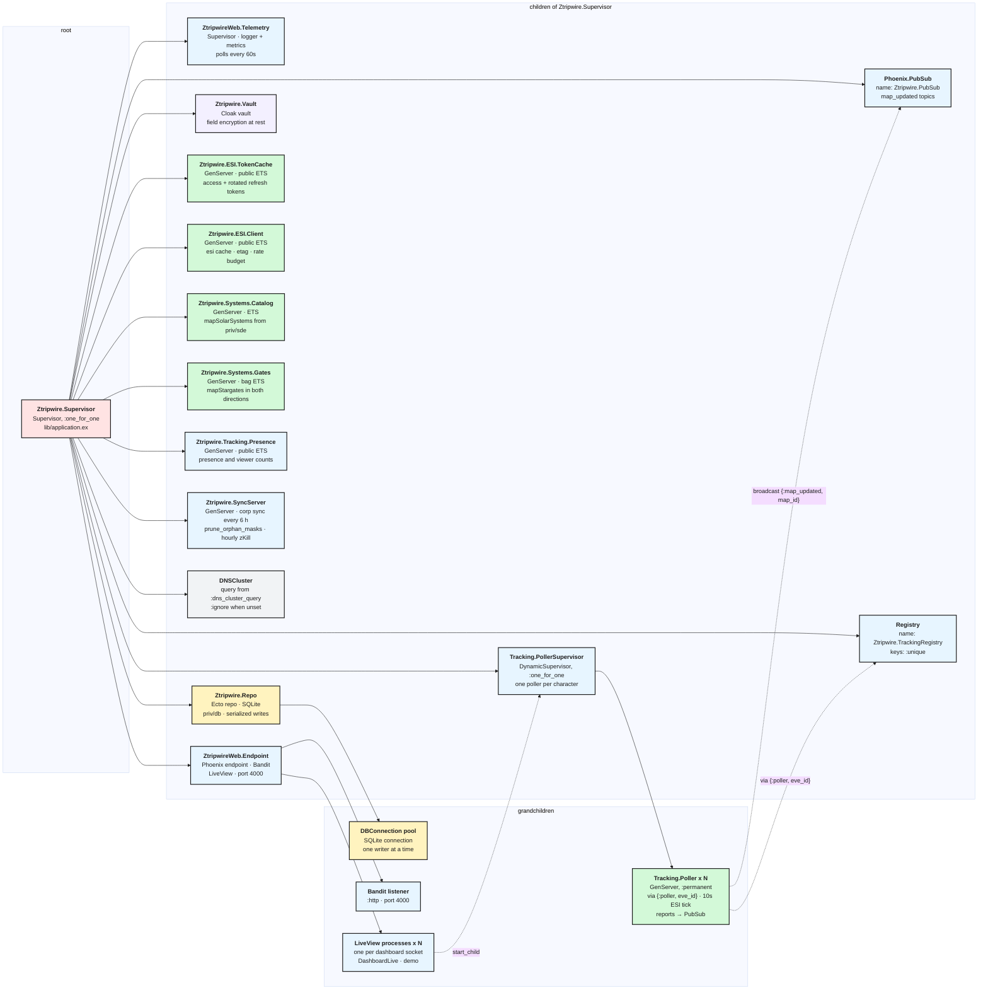
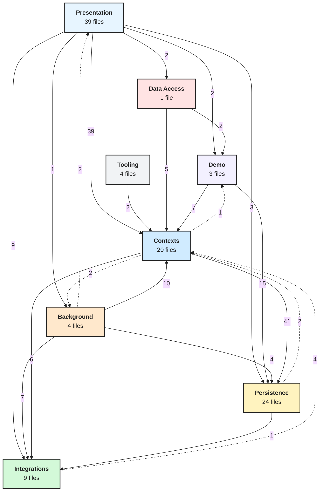

# Architecture

Generated by `mix ztripwire.diagrams` (`task diagram`). Both diagrams are Mermaid flowcharts,
so GitHub renders them as SVG. The supervision tree covers every child `Ztripwire.Application`
starts and its descendants: solid arrows are child specs, dashed arrows are the runtime
relations that are not child specs. The layer map declares its layers by path in
`Mix.Tasks.Ztripwire.Diagrams`; an arrow is drawn only when `mix xref graph` sees at least one
reference from the source layer to the target layer, labelled with that count, solid for a
forward reference and dashed for a back reference. `Data Access` is `Ztripwire.Data`, which
resolves every read and write to either the database (`Persistence`) or the in-memory demo
(`Demo`), so both arrows leave that layer.

## Supervision tree

## Layers

| Layer | Files | Paths |
|---|---|---|
| Presentation | 39 | `web/` |
| Tooling | 4 | `lib/mix/` |
| Data Access | 1 | `lib/ztripwire/data.ex` |
| Demo | 3 | `lib/ztripwire/demo.ex`, `lib/ztripwire/demo/` |
| Background | 4 | `lib/application.ex`, `lib/ztripwire/sync_server.ex`, `lib/ztripwire/tracking/poller.ex`, `lib/ztripwire/tracking/poller_supervisor.ex` |
| Contexts | 20 | `lib/` |
| Persistence | 24 | `lib/repo.ex`, `lib/ztripwire/ecto_types/` |
| Integrations | 9 | `lib/mailer.ex`, `lib/ztripwire/esi.ex`, `lib/ztripwire/esi/`, `lib/ztripwire/sso.ex`, `lib/ztripwire/systems/catalog.ex`, `lib/ztripwire/systems/gates.ex`, `lib/ztripwire/vault.ex`, `lib/ztripwire/zkill.ex` |

## External services

- **EVE SSO**: ueberauth and `Ztripwire.SSO` token refresh over HTTPS
- **EVE ESI**: `Ztripwire.ESI` location, ship, online, corporation and alliance endpoints
- **zKillboard**: `Ztripwire.ZKill` system activity statistics
- **SDE archive**: `priv/sde` JSONL zip read into `Systems.Catalog` / `Systems.Gates` ETS tables
- **SMTP**: `Ztripwire.Mailer` through Swoosh
- **EVE image CDN**: `Ztripwire.EveImages` portrait, render and logo URLs

## Coverage

Every module under `lib/` and `web/` belongs to a layer.
