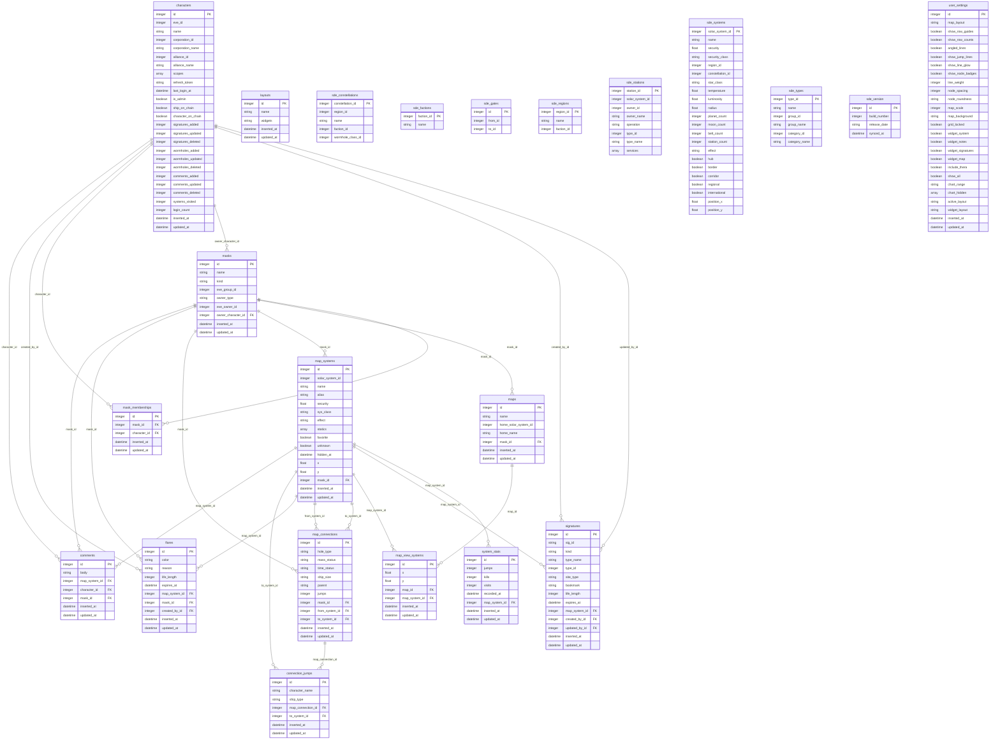

# Database Schema

Generated by `mix ztripwire.diagrams` (`task diagram`). 22 tables and
22 relationships, reflected from the Ecto schemas; primary keys are
marked `PK` and foreign keys `FK`.

## Not modelled

Created by the migrations but missing from this diagram because they have no Ecto schema: `map_permissions`.
